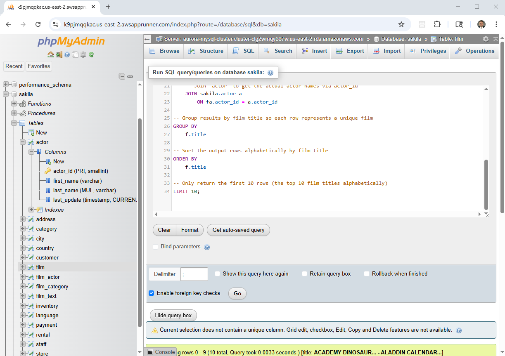
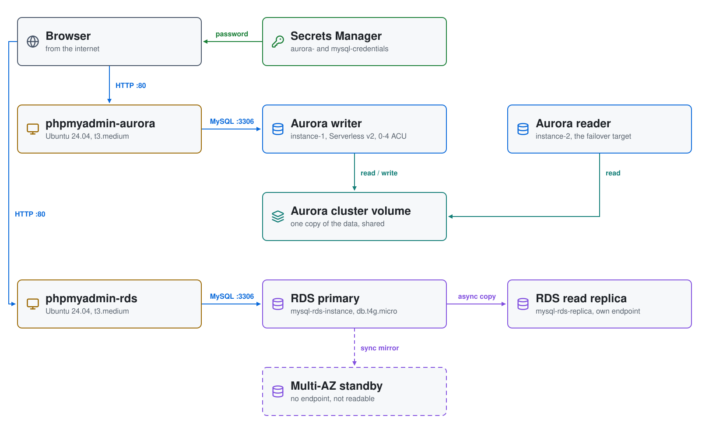

# MySQL on AWS: Amazon RDS and Aurora, side by side

Both of AWS's managed MySQL engines, built from one Terraform stack and loaded
with the same data. **Amazon RDS for MySQL** runs as a Multi-AZ primary with
a read replica; **Aurora MySQL** runs as a Serverless v2 cluster with a writer
and a reader. Each engine gets its own **phpMyAdmin** host, and both are
loaded with the [Sakila](https://dev.mysql.com/doc/sakila/en/) sample
database, so you can compare them on the same queries.



| Piece | Where | Role |
|---|---|---|
| **RDS primary** | `rds-subnet-1`/`-2` | `mysql-rds-instance`, `db.t4g.micro`, 20 GB gp3, Multi-AZ |
| **Multi-AZ standby** | the other AZ | synchronous copy of the primary; no endpoint |
| **RDS read replica** | `rds-subnet-1`/`-2` | `mysql-rds-replica`, asynchronous copy with its own endpoint |
| **Aurora cluster** | `rds-subnet-1`/`-2` | `aurora-mysql-cluster`, Serverless v2 (0–4 ACU), writer `aurora-mysql-instance-1`, reader `aurora-mysql-instance-2` |
| **phpmyadmin-rds** / **phpmyadmin-aurora** | `rds-subnet-1` | Ubuntu 24.04, `t3.medium`; Apache + phpMyAdmin pointed at one engine each |
| **Secrets Manager** | regional | `mysql-credentials` and `aurora-credentials`: user, password, endpoint |

## Architecture

<picture>
  <source media="(prefers-color-scheme: dark)" srcset="architecture-dark.svg">
  
</picture>

Regenerate with `python3 make_diagram.py`.

- **`01-rds/`** is the whole stack: the VPC (`rds-vpc`, 10.0.0.0/24) with two
  public subnets (`rds-subnet-1` in us-east-2a, `rds-subnet-2` in us-east-2b),
  the security groups, both database engines, the credentials in Secrets
  Manager, and the two phpMyAdmin hosts.
- **`01-rds/data/`** holds the two sample queries below.

## How the two engines differ

| | RDS for MySQL | Aurora MySQL |
|---|---|---|
| Copies of the data | three: primary, standby, replica | one cluster volume, shared by every instance |
| What you can read | the primary and the replica, each on its own endpoint | the writer on the cluster endpoint, the reader on the reader endpoint |
| The standby | real and billed, but no endpoint and not readable | none: the reader is the failover target |
| Compute | fixed instance class (`db.t4g.micro`) | Serverless v2, 0–4 ACU; at 0 the instances pause when idle |
| Parameters | custom group, `mysql8.4` family, `log_bin_trust_function_creators = 1` for Sakila's functions and triggers | cluster defaults |

### When the writer fails

| Action | Engine | What happens |
|---|---|---|
| **Failover** (`aws rds failover-db-cluster`) | Aurora | The reader and the writer trade places. The cluster endpoint follows the new writer. Nothing to copy, and it's reversible: fail over again to swap back. |
| **Reboot with failover** (`aws rds reboot-db-instance --force-failover`) | RDS | The standby takes over. The endpoint name stays the same, and a new standby is built behind it. |
| **Promote** (`aws rds promote-read-replica`) | RDS | The replica breaks off into its own database. Replication stops for good; there's no un-promote. |

## How it boots

1. Terraform builds the network, both engines and the secrets, generating a
   24-character password for each engine's `admin` user.
2. Each phpMyAdmin host installs Apache, PHP, phpMyAdmin and the MySQL
   client, and points phpMyAdmin at its engine's writer endpoint with cookie
   sign-in, so you sign in with the engine's `admin` password.
3. It downloads Sakila from dev.mysql.com and loads the schema and data into
   its engine. Progress is in `/root/userdata.log`.

## Security groups

```
internet ─80───▶ phpmyadmin-rds, phpmyadmin-aurora
internet ─3306─▶ RDS primary, read replica, Aurora writer and reader
```

Both groups (`http-sg` and `rds-sg`) allow `0.0.0.0/0`. Every database is
publicly accessible, so you can also connect a local MySQL client to any
endpoint with the `admin` password.

## Prerequisites

* [An AWS Account](https://aws.amazon.com/console/)
* [Install AWS CLI](https://docs.aws.amazon.com/cli/latest/userguide/getting-started-install.html)
* [Install Terraform](https://developer.hashicorp.com/terraform/install)
* [Install jq](https://jqlang.github.io/jq/download/)

If this is your first time watching our content, we recommend starting with
this video: [AWS + Terraform: Easy Setup](https://youtu.be/BCMQo0CB9wk).

## Deploy

```bash
git clone https://github.com/mamonaco1973/aws-mysql.git
cd aws-mysql
./apply.sh       # one phase: VPC, RDS, Aurora, secrets, phpMyAdmin hosts
```

Everything deploys to `us-east-2`. `apply.sh` ends by running `validate.sh`,
which prints the two phpMyAdmin URLs:

```
==========================================================================
 phpMyAdmin Endpoints
==========================================================================

 RDS phpMyAdmin URL:
   http://ec2-203-0-113-10.us-east-2.compute.amazonaws.com/phpmyadmin/

 Aurora phpMyAdmin URL:
   http://ec2-203-0-113-20.us-east-2.compute.amazonaws.com/phpmyadmin/

==========================================================================
```

## Try it

1. Get an engine's password:

   ```bash
   aws secretsmanager get-secret-value --secret-id mysql-credentials \
     --query SecretString --output text | jq -r .password
   ```

   Use `aurora-credentials` for Aurora. The user is `admin` for both.

2. Open each phpMyAdmin URL and sign in as `admin`. The `sakila` database is
   in the tree on the left.
3. Run the same queries on both engines (`01-rds/data/`):

   ```sql
   SELECT
       f.title AS film_title,
       CONCAT(a.first_name, ' ', a.last_name) AS actor_name
   FROM sakila.film f
   JOIN sakila.film_actor fa ON f.film_id = fa.film_id
   JOIN sakila.actor a ON fa.actor_id = a.actor_id
   ORDER BY f.title, actor_name
   LIMIT 20;
   ```

   ```sql
   SELECT
       f.title,
       GROUP_CONCAT(
           CONCAT(a.first_name, ' ', a.last_name)
           ORDER BY a.last_name
           SEPARATOR ', '
       ) AS actor_names
   FROM sakila.film f
   JOIN sakila.film_actor fa ON f.film_id = fa.film_id
   JOIN sakila.actor a ON fa.actor_id = a.actor_id
   GROUP BY f.title
   ORDER BY f.title
   LIMIT 10;
   ```

4. Try a failover from the table above, then refresh phpMyAdmin.

## Troubleshooting

| Symptom | Fix |
|---|---|
| phpMyAdmin doesn't load | The host is still installing. `aws ssm start-session --target <instance-id>`, then `sudo tail /var/log/cloud-init-output.log`. |
| `sakila` is missing | Check `/root/userdata.log` on that engine's phpMyAdmin host for the `mysql` load output. |
| The first Aurora query after a quiet spell is slow | At 0 ACU the Aurora instances pause when idle; the first connection resumes them. |
| Sign-in fails | Use the password from that engine's secret; the two engines have different passwords. |

## Teardown

```bash
./destroy.sh     # destroys the whole stack; no final snapshots, secrets deleted immediately
```

## Notes

- **Lab only.** The databases and phpMyAdmin are open to the internet,
  phpMyAdmin runs over plain HTTP, and the admin passwords are in the hosts'
  user data. The hosts' IAM role also has `AmazonSSMFullAccess`. Put the
  databases in private subnets and restrict the security groups for anything
  more.
- `phpmyadmin.png` was taken on an earlier version of this lab, when
  phpMyAdmin ran on App Runner.
